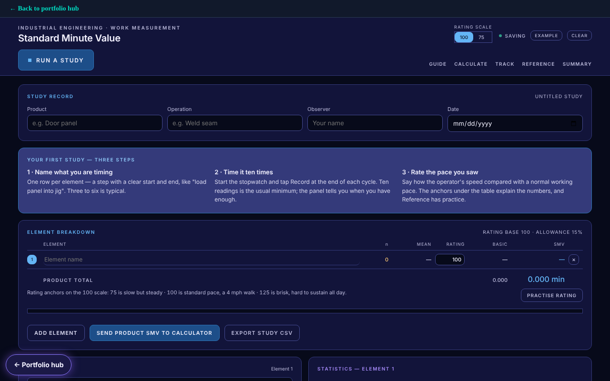

# Standard Minute Value (SMV) Tool

[Try it live](https://rmilburn1980.github.io/SMV-TOOL/) · [Portfolio hub](https://rmilburn1980.github.io/)

Run a time study, then calculate the standard minute value, line efficiency and production targets. Includes a formula reference, practice problems and MOST sequence models.

It is a single HTML page with no build step and no server. Data stays in your browser. Chart code is served from the `vendor` folder.

Part of my portfolio: https://rmilburn1980.github.io/

The tool is decision support only. Check any target against your own time study before using it.
